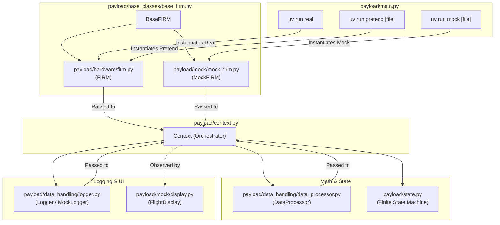
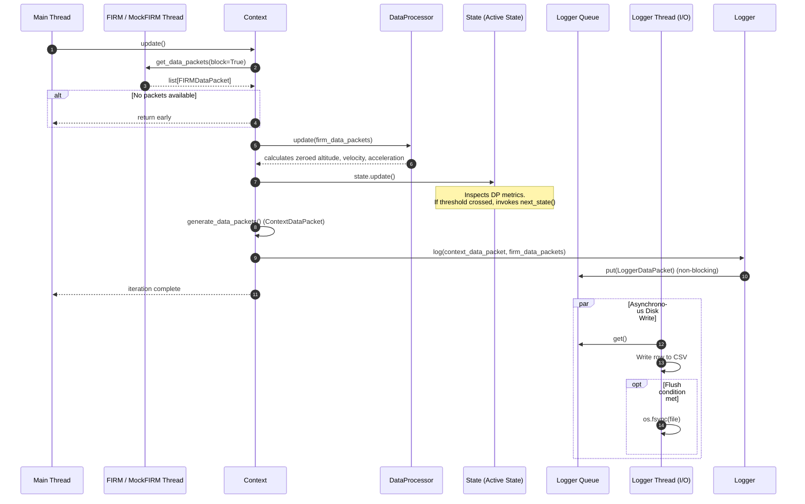
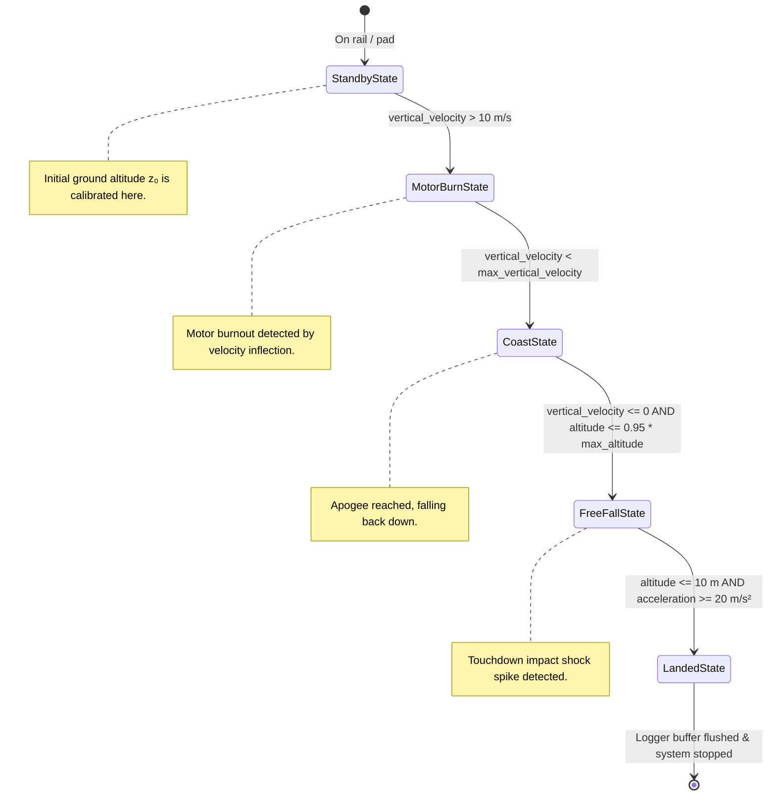

# System Architecture & Codebase Structure

Comprehensive architectural documentation for the **NCSU High Powered Rocketry Club Payload Template** (`PayloadTemplate`).

---

## 1. Overview & System Mission

This repository provides a modular, multithreaded Python template for high-power rocket payloads (as used in NCSU's Airbrakes and Payload flight systems). 

The application:
1. Reads telemetry from the **FIRM** (Flight Inertial & Recovery Module) avionics computer or simulates it from log files.
2. Performs numerical processing in real time (zeroing altitude to ground level, vertical velocity, acceleration integration).
3. Drives a deterministic **Finite State Machine (FSM)** through flight stages (`Standby` $\to$ `MotorBurn` $\to$ `Coast` $\to$ `FreeFall` $\to$ `Landed`).
4. Logs telemetry to timestamped CSV files using an asynchronous, non-blocking I/O background thread.
5. Renders a terminal display with real-time flight metrics.

---

## 2. Repository File Manifest

Every file in this repository is listed below with its role and responsibility.

```
NCSU-Fall2026-Rocketry-Club-Code/
├── README.md                                # Quickstart guide, installation, and run instructions
├── pyproject.toml                           # Package metadata, uv dependencies, CLI scripts, linter rules
├── uv.lock                                  # Locked dependency versions for reproducible builds
├── structure.md                             # (This file) Complete architectural documentation
├── launch_data/                             # Flight logs for simulations and test replays
│   ├── raw_firm_data/
│   │   └── jackpot_1_nosecone.FRM           # Binary log file recorded by FIRM hardware
│   └── real_firm_launches/
│       └── jackpot_launch_4.csv             # CSV telemetry replay from a past flight
└── payload/                                 # Core source package
    ├── __init__.py                          # Package root
    ├── main.py                              # Entry points (real, mock, pretend) & flight lifecycle loop
    ├── context.py                           # State machine orchestrator & dependency container
    ├── state.py                             # FSM State definitions & transition criteria
    ├── constants.py                         # System thresholds, serial ports, buffers, stop signals
    ├── utils.py                             # Time conversion, queue draining, CLI argument parser
    ├── base_classes/
    │   ├── __init__.py                      # Base classes package marker
    │   └── base_firm.py                     # BaseFIRM abstract base class defining hardware interface
    ├── hardware/
    │   ├── __init__.py                      # Hardware package marker
    │   └── firm.py                          # Hardware FIRM implementation wrapping firm-client
    ├── data_handling/
    │   ├── __init__.py                      # Data handling package marker
    │   ├── data_processor.py                # Vectorized NumPy math for velocity, altitude, and stats
    │   ├── logger.py                        # Threaded, non-blocking CSV telemetry logger
    │   └── packets/
    │       ├── __init__.py                  # Packets package marker
    │       ├── context_data_packet.py       # msgspec Struct for FSM context snapshot & metadata
    │       ├── logger_data_packet.py        # msgspec Struct specifying CSV log schema & ordering
    │       └── processor_data_packet.py     # msgspec Struct for processed mathematical data
    └── mock/
        ├── __init__.py                      # Mock package marker
        ├── display.py                       # Real-time ANSI terminal UI dashboard (FlightDisplay)
        ├── mock_firm.py                     # CSV replay engine simulating FIRM hardware (MockFIRM)
        └── mock_logger.py                   # Testing logger variant with automatic file cleanup
```

### Detailed File Responsibilities

| File | Primary Classes / Functions | Responsibility |
| :--- | :--- | :--- |
| `pyproject.toml` | N/A | Declares dependencies (`firm-client`, `polars`, `msgspec`, `colorama`, `numpy`), dev tools (`pytest`, `ruff`), and CLI script aliases (`uv run real`, `uv run mock`, `uv run pretend`). |
| `payload/main.py` | `run_real_flight`, `run_mock_flight`, `run_pretend_flight`, `run_flight`, `create_components`, `run_flight_loop` | CLI entry points; creates FIRM, Logger, DataProcessor; wires them into `Context`; drives the synchronous `context.update()` loop. |
| `payload/context.py` | `Context` | The central state machine orchestrator and service container. Coordinates data flow: fetches FIRM packets $\to$ feeds `DataProcessor` $\to$ updates `State` $\to$ snapshots `ContextDataPacket` $\to$ dispatches to `Logger`. |
| `payload/state.py` | `State` (ABC), `StandbyState`, `MotorBurnState`, `CoastState`, `FreeFallState`, `LandedState` | Finite state machine logic. Evaluates sensor triggers (takeoff velocity, burnout deceleration, apogee inflection, touchdown shock) and transitions state. |
| `payload/constants.py` | Physical & operational constants | Defines flight thresholds (`TAKEOFF_VELOCITY_METERS_PER_SECOND`, `MAX_ALTITUDE_THRESHOLD`, `GROUND_ALTITUDE_METERS`), buffer sizes, serial baud rates, and `DisplayEndingType`. |
| `payload/utils.py` | `arg_parser`, `get_all_packets_from_queue`, `convert_ns_to_s`, `convert_s_to_ns`, `convert_unknown_type_to_float` | Utility helpers for CLI parsing, time unit conversion, and draining Python `SimpleQueue` safely without deadlock. |
| `payload/base_classes/base_firm.py` | `BaseFIRM` (ABC) | Contract for FIRM interactions (`start()`, `stop()`, `get_data_packets()`, `is_running`, `requested_to_run`). Enables polymorphic swapping between hardware and mock instances. |
| `payload/hardware/firm.py` | `FIRM` | Implements `BaseFIRM` for physical flight hardware via `firm_client.FIRMClient`. Detects OS platform (Linux `/dev/ttyACM0` vs. Windows `COM5`) and handles "pretend" streaming from `.FRM` files. |
| `payload/mock/mock_firm.py` | `MockFIRM` | Implements `BaseFIRM` for offline testing. Uses Polars (`pl.scan_csv`) to parse recorded CSVs, matching `FIRMDataPacket` fields, and feeds packets at either real-time speed (100 Hz) or full CPU speed. |
| `payload/data_handling/data_processor.py` | `DataProcessor` | Calculates relative altitude $z - z_0$, vertical velocity, vertical acceleration, and peak records using vectorized NumPy arrays. Generates `ProcessorDataPacket`s. |
| `payload/data_handling/logger.py` | `Logger` | Background I/O thread. Buffers early launch data (`_log_buffer` deque of 5,000 packets) and writes `LoggerDataPacket` rows to `logs/log_N.csv`, periodically executing `os.fsync`. |
| `payload/mock/mock_logger.py` | `MockLogger` | Subclass of `Logger` that automatically unlinks (deletes) the generated log file on `stop()` unless `--keep-log-file` is requested. |
| `payload/mock/display.py` | `FlightDisplay` | Background thread rendering a live terminal dashboard displaying current state, T+ mission clock, current/max altitude, and velocity. Uses ANSI escape sequences to update in-place. |
| `payload/data_handling/packets/context_data_packet.py` | `ContextDataPacket` | `msgspec.Struct` storing current `State` type, retrieved packet batch counts, nanosecond host timestamp, and human-readable epoch time. |
| `payload/data_handling/packets/logger_data_packet.py` | `LoggerDataPacket` | `msgspec.Struct` defining the exact schema and column ordering for output CSV flight logs. |
| `payload/data_handling/packets/processor_data_packet.py` | `ProcessorDataPacket` | `msgspec.Struct` holding computed metrics: zeroed ground altitude, vertical velocity, and timestamp. |

---

## 3. Architecture & Data Flow

### 3.1 High-Level Component Relationship



---

### 3.2 The Runtime Execution Loop (`Context.update()`)

During each iteration of the main flight loop in `main.py`, the following sequence executes:



---

### 3.3 Threading Model

The application uses **3 or 4 concurrent threads** to achieve real-time responsiveness without I/O blocking:

1. **Main Thread**: Runs the synchronous control loop (`context.update()`). Responsible for state transitions and algorithm execution.
2. **FIRM Data Fetch Thread**:
   - In `FIRM`: `firm_client` reads incoming serial packets from the flight hardware over USB/UART.
   - In `MockFIRM`: A dedicated thread reads lines from the CSV via Polars and pushes `FIRMDataPacket` items into a thread-safe `SimpleQueue`.
3. **Logger Thread**: A daemon thread consuming `LoggerDataPacket`s from a `SimpleQueue`. It converts them using `msgspec.to_builtins` and writes to CSV, ensuring disk writes never slow down the flight loop.
4. **Display Thread**: A daemon thread in `FlightDisplay` that periodically polls the `Context` and refreshes the console output using ANSI cursor repositioning.

---

### 3.4 Finite State Machine (FSM) Transitions



---

## 4. Packet Structures & Data Flow

Data contracts are built using [`msgspec.Struct`](https://jcristharif.com/msgspec/), which provides fast serialization, low memory overhead, and strict type constraints.

1. **`FIRMDataPacket`** (from `firm-client`):
   - Ingested directly from hardware or `MockFIRM`.
   - Contains raw timestamp, 3-axis accelerometer readings ($g$), orientation, temperature, and Kalman-filtered estimates (`est_position_z_meters`, `est_velocity_z_meters_per_s`).
2. **`ProcessorDataPacket`** (`payload/data_handling/packets/processor_data_packet.py`):
   - Created by `DataProcessor.get_processor_data_packets()`.
   - Stores computed ground-relative altitude (`current_altitude`), `vertical_velocity`, and timestamp.
3. **`ContextDataPacket`** (`payload/data_handling/packets/context_data_packet.py`):
   - Generated by `Context.generate_data_packets()`.
   - Captures current state type (`state: type[State]`), number of packets in the last batch, host nanosecond timestamp (`update_timestamp_ns`), and human-readable epoch string.
4. **`LoggerDataPacket`** (`payload/data_handling/packets/logger_data_packet.py`):
   - Created in `Logger._prepare_logger_packets()`.
   - Merges `ContextDataPacket` metadata with individual `FIRMDataPacket` fields.
   - The field order in `LoggerDataPacket` directly sets the CSV column header order.

---

## 5. How to Add New Functionality Without Breaking Anything

Follow the guidelines below to extend the system while maintaining architecture integrity, performance, and type safety.

---

### 5.1 Adding a New Hardware Component (e.g., Actuators, Servos, Airbrakes, Sensors)

To control hardware (e.g., servos for airbrakes or release mechanisms):

1. **Define an Interface / Base Class**:
   Create an abstract base class in `payload/base_classes/base_<device>.py`:
   ```python
   from abc import ABC, abstractmethod

   class BaseActuator(ABC):
       __slots__ = ()

       @abstractmethod
       def set_extension(self, percent: float) -> None:
           """Deploy actuator between 0.0 and 1.0."""

       @abstractmethod
       def stop(self) -> None:
           """Retract and de-energize."""
   ```
2. **Implement Real & Mock Variants**:
   - Put real hardware driver code in `payload/hardware/<device>.py` (e.g. using `gpiozero` or serial commands).
   - Put simulation/mock code in `payload/mock/mock_<device>.py` (printing or recording movements without GPIO).
3. **Add Component to `Context`**:
   - Update `Context.__slots__` in `payload/context.py` to include your device reference.
   - Accept the device in `Context.__init__(self, firm, logger, data_processor, actuator: BaseActuator)`.
   - Ensure `context.stop()` calls `self.actuator.stop()`.
4. **Update `main.py`**:
   - In `create_components(args)`, instantiate either the mock or real actuator depending on `args.mode`.
5. **Control the Component from `State`**:
   - States can access your device through `self.context.actuator.set_extension(...)`.

---

### 5.2 Adding or Modifying a State in the State Machine

If your mission introduces extra phases (e.g., `AirbrakesActiveState`, `DrogueChuteState`, or `PayloadDeploymentState`):

1. **Subclass `State` in `payload/state.py`**:
   ```python
   from payload.state import State

   class PayloadDeploymentState(State):
       __slots__ = ()

       def update(self) -> None:
           data = self.context.data_processor
           # Check conditions to transition:
           if data.current_altitude < 500.0:  # e.g., deploy below 500m
               self.next_state()

       def next_state(self) -> None:
           self.context.state = LandedState(self.context)
   ```
2. **Update the Preceding State's `next_state`**:
   - Direct the prior state (e.g. `FreeFallState.next_state()`) to instantiate `PayloadDeploymentState(self.context)` instead of `LandedState`.
3. **Declare New Threshold Constants**:
   - Place any trigger thresholds (e.g., `DEPLOYMENT_ALTITUDE_METERS`) into `payload/constants.py` rather than hardcoding numbers.
4. **Preserve `__slots__ = ()`**:
   - All state subclasses define `__slots__ = ()` to prevent dynamic `__dict__` overhead and maintain fast execution.

---

### 5.3 Adding New Calculations to `DataProcessor`

To compute new flight parameters (such as pitch/yaw angle, roll rate, total energy, or Mach number):

1. **Add Property & Storage in `payload/data_handling/data_processor.py`**:
   - Add new attributes to `__slots__` (e.g., `_mach_numbers`).
   - Initialize the attribute in `__init__`: `self._mach_numbers = np.array([0.0])`.
2. **Update Vectorized Math in `DataProcessor.update()`**:
   - Compute the new values across the batch of `FIRMDataPacket`s using NumPy for speed:
     ```python
     self._mach_numbers = np.fromiter(
         (packet.est_velocity_z_meters_per_s / 343.0 for packet in self._data_packets),
         dtype=np.float64,
     )
     ```
3. **Expose via Read-Only Properties**:
   - Add a `@property` returning `float(self._mach_numbers[-1])`.
4. **Include in `ProcessorDataPacket`** (if required downstream):
   - Add the field to `payload/data_handling/packets/processor_data_packet.py`.
   - Populate it inside `DataProcessor.get_processor_data_packets()`.

---

### 5.4 Adding Fields to the CSV Flight Log

To log additional data to `logs/log_N.csv`:

1. **Update `payload/data_handling/packets/logger_data_packet.py`**:
   - Add the field with its type annotation and default value:
     ```python
     class LoggerDataPacket(msgspec.Struct, array_like=True, kw_only=True):
         ...
         new_telemetry_field: float | None = None
     ```
   > **Note**: Because `Logger` automatically reads `LoggerDataPacket.__struct_fields__` to create the CSV header, adding the field here will automatically add the CSV column.
2. **Populate the Field in `payload/data_handling/logger.py`**:
   - In `Logger._prepare_logger_packets()`, map the incoming data:
     ```python
     logger_packet.new_telemetry_field = firm_data_packet.some_value
     ```

---

### 5.5 Critical Rules & Conventions

To prevent bugs and performance regressions:

* **Always declare `__slots__`**: Every class in `payload/` uses `__slots__` to minimize memory usage and maximize attribute access speed.
* **Keep `Context.update()` fast**: Never perform blocking I/O (disk writes, network calls, large print statements) inside the main loop. Offload I/O to background threads via `queue.SimpleQueue`.
* **Thread Termination & Stop Signals**: When writing worker threads, always listen for `STOP_SIGNAL` (`"STOP"`) and use `threading.Event` to ensure clean shutdown when `Context.stop()` is invoked.
* **Data Types with `msgspec`**: `msgspec.Struct` is strict. When converting NumPy floats (e.g. `np.float64`), ensure they are cast to native Python `float` or handled with an encoder hook (see `convert_unknown_type_to_str` in `logger.py`).
* **Platform Portability**: When specifying serial ports, preserve the OS detection logic in `payload/hardware/firm.py` (`platform.system() == "Linux"` vs Windows COM port).

---

## 6. How to Run & Validate Changes

```bash
# 1. Sync dependencies
uv sync

# 2. Replay recorded flight data at full speed (Mock mode)
uv run mock launch_data/real_firm_launches/jackpot_launch_4.csv -f

# 3. Replay recorded flight in real-time with debug output
uv run mock launch_data/real_firm_launches/jackpot_launch_4.csv -l

# 4. Replay from raw .FRM file (Pretend mode with FIRM hardware connected)
uv run pretend launch_data/raw_firm_data/jackpot_1_nosecone.FRM

# 5. Run linter and formatting check
uv run ruff check .
```

